# Writeup: Insider (CyberDefenders)

**Plataforma:** CyberDefenders · **Categoría:** Endpoint Forensics · **Dificultad:** Easy
**Herramienta principal:** FTK Imager · **Evidencia:** imagen forense `FirstHack.ad1` (estación Linux)

---

## 1. Resumen

El escenario plantea a un analista SOC que investiga a una empleada, Karen, sospechada de actividad ilegal dentro de su organización. El análisis se hace sobre la imagen forense de su estación de trabajo Linux (Kali). Revisando logs del sistema, el historial de Bash, archivos descargados y artefactos del usuario `root`, se reconstruyó qué herramientas ofensivas usó, qué archivos creó y que su máquina se utilizó para atacar a otro equipo.

## 2. Entorno y herramientas

- **Máquina virtual aislada** (VirtualBox, Windows 11), sin carpetas compartidas, con la red desconectada al abrir la evidencia.
- **FTK Imager** para explorar la imagen en modo lectura, sin ejecutar nada de su contenido.
- Se sacó una **instantánea limpia** de la VM antes de abrir la evidencia.
- Al terminar el análisis, **restauré la VM a esa instantánea limpia**, así no quedan restos de la evidencia y el próximo laboratorio arranca desde un estado conocido.

## 3. Integridad de la evidencia

Antes de analizar, verifiqué la integridad de la imagen con **File → Verify Drive/Image** en FTK Imager, que calcula los hashes de `FirstHack.ad1` y los compara con los guardados en el reporte que acompaña al lab.

| Algoritmo | Hash calculado | Hash del reporte | Resultado |
|-----------|----------------|------------------|-----------|
| MD5 | `f7c4fab05c3a7473ed59b549eef5a509` | `f7c4fab05c3a7473ed59b549eef5a509` | **Match** |
| SHA1 | `8875899aa4c6498b410250d48503f64e283528e9` | `8875899aa4c6498b410250d48503f64e283528e9` | **Match** |

Ambos hashes coinciden, por lo que la evidencia está íntegra y no fue alterada.

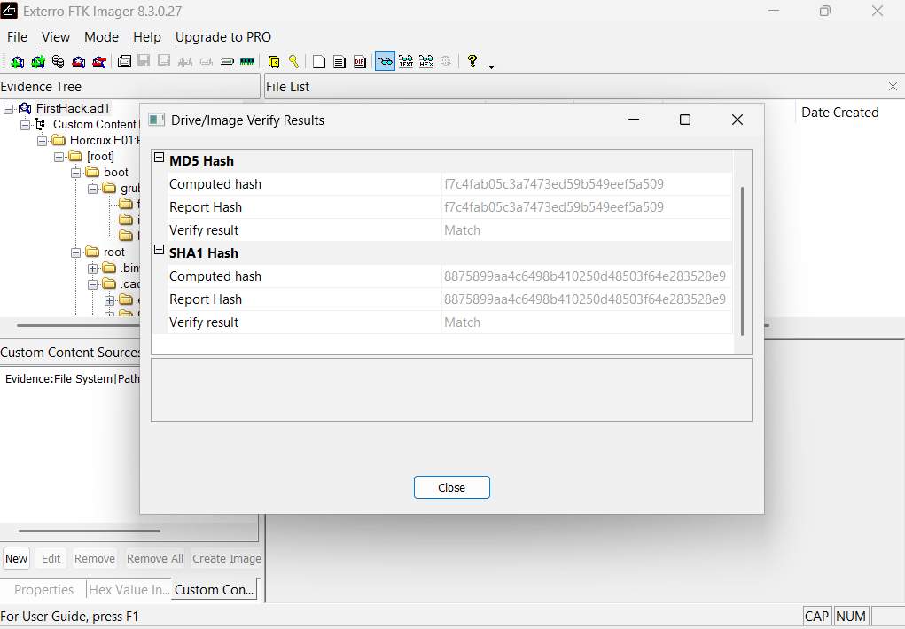

---

## 4. Análisis

### Q1. ¿Qué distribución de Linux se usa en esta máquina?

Fui a `/var/log` y abrí el archivo `syslog`. Las líneas del sistema mostraban que la máquina corría **Kali Linux**, una distribución orientada a pruebas de penetración, lo que ya da contexto sobre el uso del equipo.

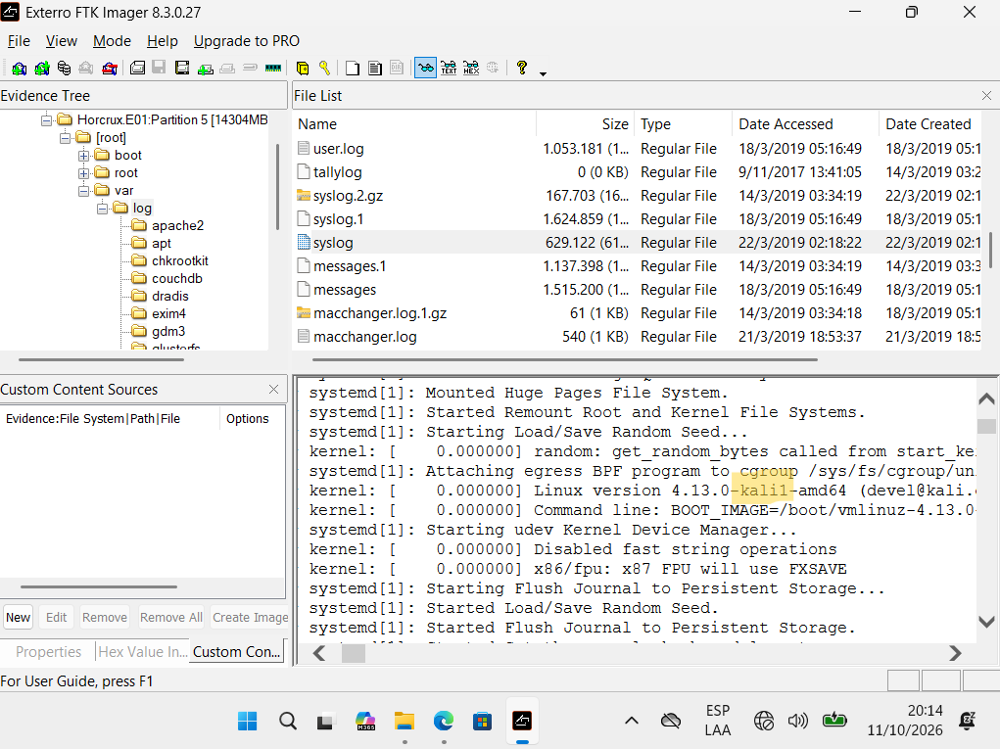

### Q2. ¿Cuál es el hash MD5 del `access.log` de Apache?

Navegué a `/var/log/apache2/` y encontré `access.log`. En FTK Imager hice clic derecho sobre el archivo y usé **Export File Hash List**, que generó un `hash.csv` con el MD5 y el SHA1 de ese archivo, junto con su ruta dentro de la imagen.

- MD5: `d41d8cd98f00b204e9800998ecf8427e`

Este valor es el MD5 conocido de un archivo **vacío** (0 bytes), y el SHA1 del mismo CSV también corresponde a un archivo vacío. Eso confirma con evidencia que el `access.log` no tenía contenido.

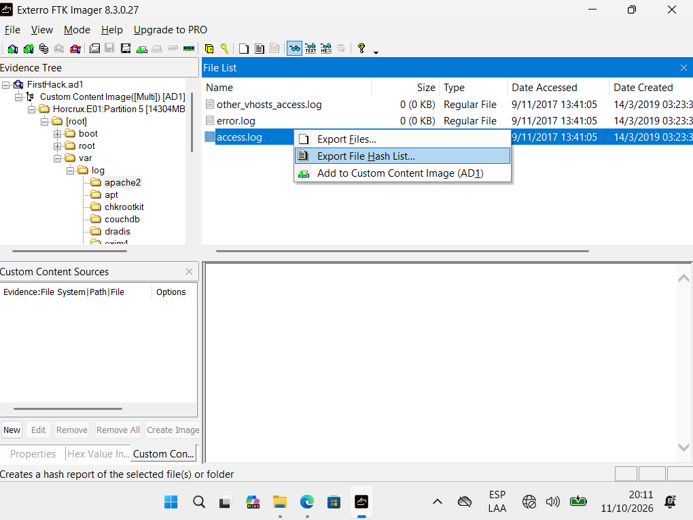

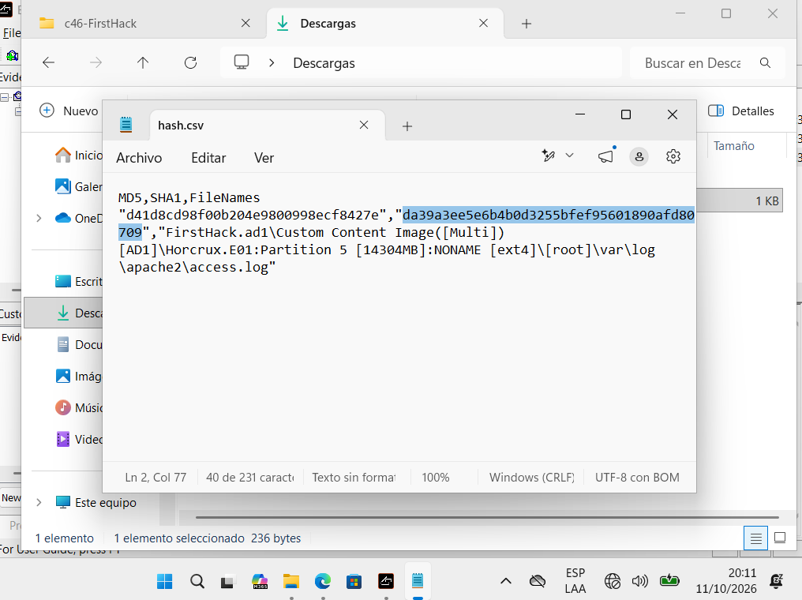

### Q3. ¿Cómo se llama el archivo descargado, una herramienta de volcado de credenciales?

Revisé la carpeta `Downloads` dentro de `/root` y encontré **`mimikatz-trunk.zip`**. Mimikatz es una herramienta conocida para extraer credenciales y hashes de Windows, lo que coincide con la descripción.

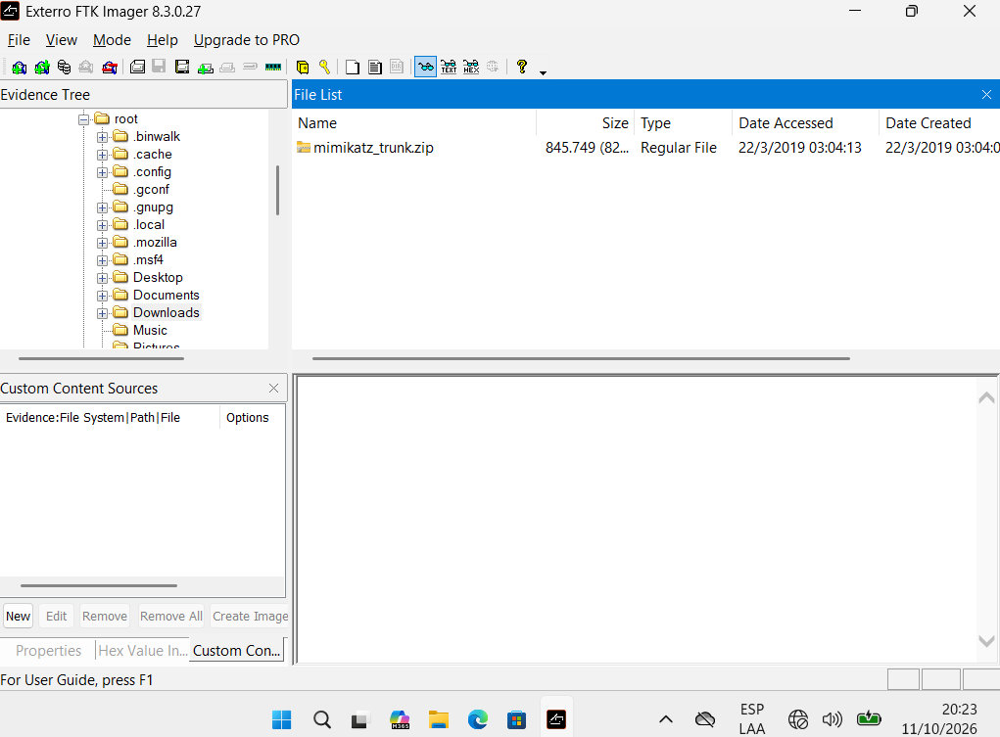

### Q4. ¿Cuál es la ruta absoluta del archivo "super secreto"?

En `/root/.bash_history` encontré el comando que crea el archivo, que quedó en la carpeta `Desktop` del usuario `root`. La ruta absoluta es **`/root/Desktop/SuperSecretFile.txt`**.

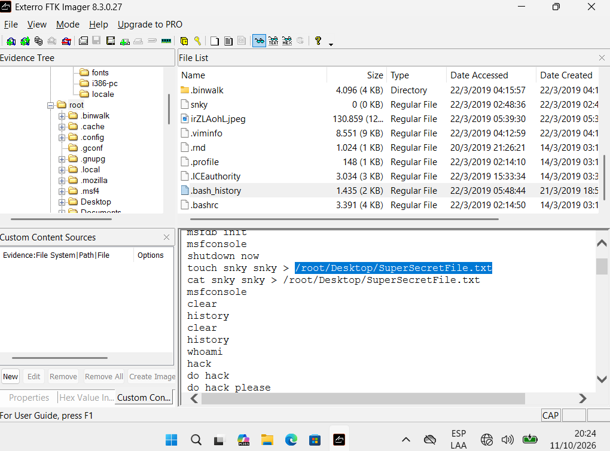

### Q5. ¿Qué programa usó `didyouthinkwedmakeiteasy.jpg` durante su ejecución?

En el mismo `.bash_history` busqué el comando que recibe ese archivo como argumento. El programa es **binwalk**, una herramienta que analiza imágenes en busca de archivos ocultos dentro de ellas. Lo respalda que en `/root` existe una carpeta `.binwalk`, creada por la propia herramienta.

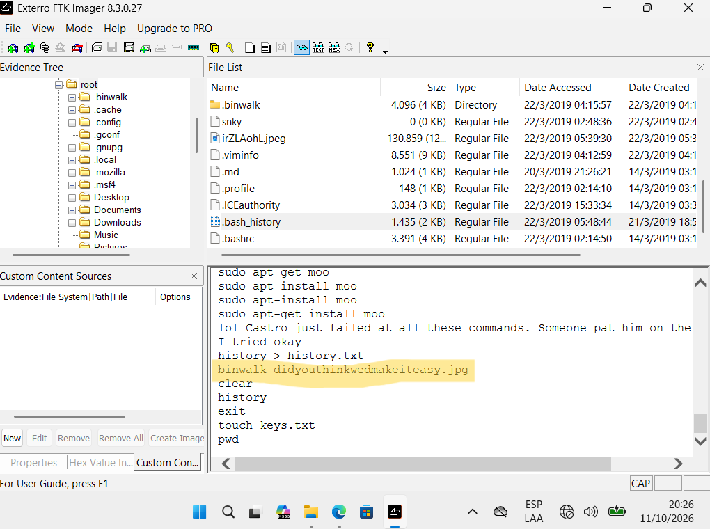

### Q6. ¿Cuál es el tercer objetivo de la lista que creó Karen?

En la carpeta `Desktop` de `root` había un archivo de texto con una lista de verificación. Lo abrí y el tercer ítem era **"profit"**.

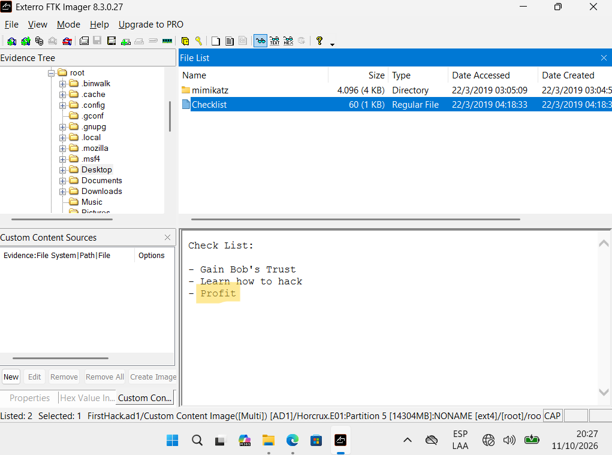

### Q7. ¿Cuántas veces se ejecutó Apache?

Fui a `/var/log/apache2/` y abrí `access.log`: estaba **vacío**, y el hash de la Q2 lo confirma (es el de un archivo de 0 bytes). El servidor no atendió ninguna petición. Concluí que Apache se ejecutó **0 veces**.

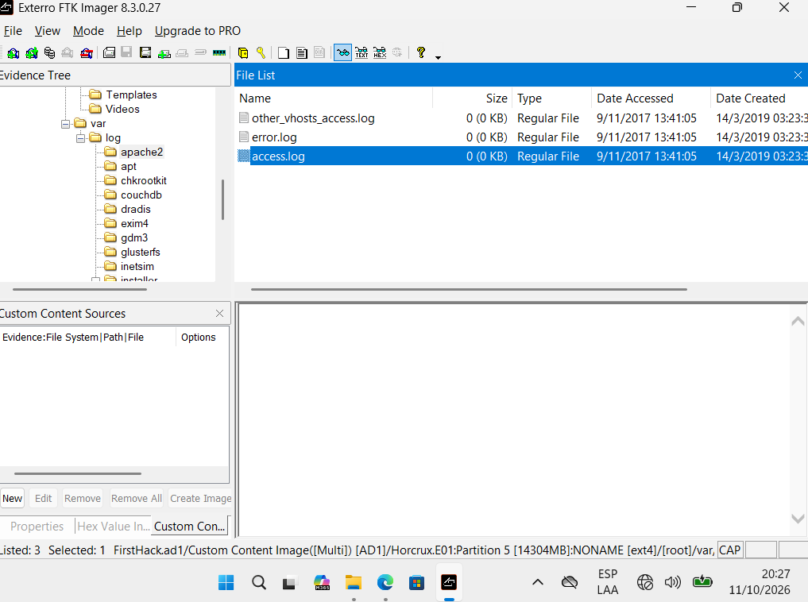

### Q8. ¿Qué archivo prueba que la máquina se usó para atacar a otra?

En `/root` encontré un archivo de imagen con nombre aleatorio, **`irZLAohL.jpeg`**, modificado el 22/3/2019. Al abrirlo en el visor de FTK Imager muestra la pantalla de otro equipo con Windows: una consola de administrador en la carpeta `Temp` de un usuario (Bob), ejecutando un programa que simula tráfico de red malicioso. Esto indica que desde la máquina de Karen se accedió a otro equipo y se capturó su pantalla como prueba.

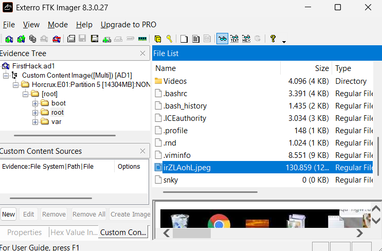

### Q9. ¿A quién provocaba Karen en un script de Bash en `Documents`?

Fui a `/root/Documents/myfirsthack/` y abrí el script **`firstscript_fixed`**. Usa `echo` para mostrar un mensaje con la frase *"Heck yeah, I can write bash too, Young"*. El mensaje está dirigido a alguien por su nombre, y el "too" indica que responde a un comentario sobre su habilidad con Bash. Asumí que el experto provocado era **Young**.

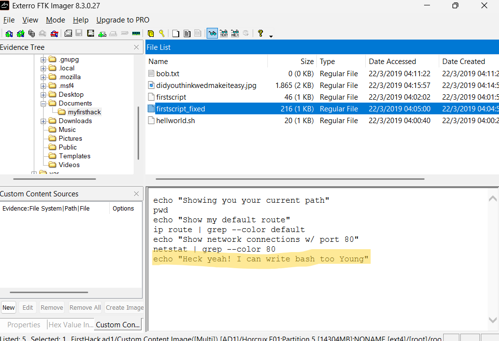

### Q10. ¿Quién ejecutó `su` a las 11:26 para obtener acceso root?

Abrí `/var/log/auth.log` y filtré las entradas de las 11:26. A las 11:26:22, el equipo (`KarenHacker`) registra:

> `su[4060]: Successful su for postgres by root`
> `su[4060]: + ??? root:postgres`

La línea indica que **`root` cambió a la cuenta `postgres`**, la del servicio de base de datos PostgreSQL. El enunciado del lab habla de un `su` a root, pero el log muestra que la cuenta involucrada en esos cambios es **`postgres`**, que es la respuesta que identifiqué.

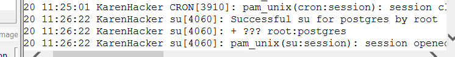

### Q11. Según el historial de Bash, ¿cuál es el directorio de trabajo actual?

Abrí `/root/.bash_history` y fui hasta la **última línea de `cd`**, que indica dónde quedó el usuario. El directorio de trabajo actual es **`/root/Documents/myfirsthack/`**.

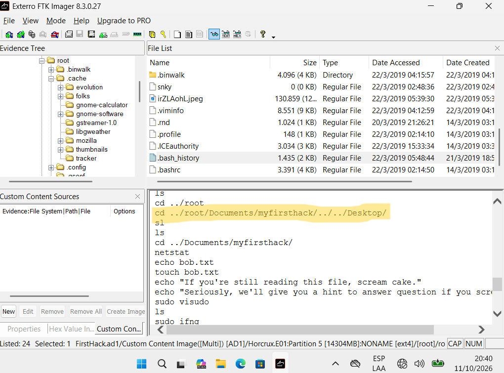

---

## 5. Conclusiones

La estación analizada pertenece a un usuario que trabajaba como `root` en Kali Linux. Hay indicios claros de actividad ofensiva: descargó **mimikatz**, usó **binwalk** sobre una imagen, mantuvo una lista de objetivos que termina en "profit", escribió scripts con mensajes dirigidos a otra persona, y guardó una captura de pantalla de otro equipo como prueba de un ataque. La imagen se verificó por hash y se analizó en un entorno aislado.

## 6. Lo aprendido

- A explorar imágenes de disco Linux con **FTK Imager** en modo lectura.
- Que el **`.bash_history`** y los logs de `/var/log` cuentan la historia del equipo: qué se ejecutó, cuándo y desde dónde.
- Que una ausencia de evidencia (un log vacío) hay que contrastarla con otras fuentes antes de afirmar que algo no ocurrió.
- La importancia de **verificar el hash** y de trabajar en un **entorno aislado** con una instantánea limpia.

## 7. Referencias

- CyberDefenders, laboratorio *Insider*.
